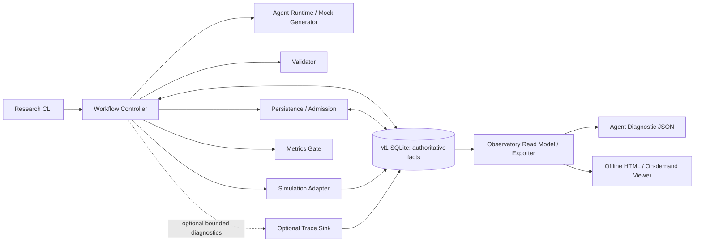

# WorldQuant Alpha Research Platform — M1-O Research Observatory 开发规格

**版本：** v0.1 · **日期：** 2026-10-30 · **状态：** 待 Codex 在实际仓库核对后实施  
**依赖：** M1 已交付，并完成 targeted correctness review（交付报告：61 tests passed）。  
**实施范围：** M1-O；不实施真实 WorldQuant API（M1.5）、Seed Reservoir/func1/func2（M2）、RAG（M3）、多 Worker 自动恢复（M4）。

> **一句话目标：** 给定 `run_id`，能够看到一次 Alpha 研究经过的模块节点、每次关键状态变更、可公开的输入/输出摘要、预算变更、异常及其来源；同时可以导出供诊断 Agent/Codex 阅读的、带证据引用的结构化报告。可视化界面按需启动，业务核心不依赖观察器运行。

## 0. 前提、事实边界和实施原则

目前只有 M1 **交付报告及修复报告**，没有本地实际源码副本。本规格中 `workflow.py`, `persistence.py`, `simulation.py`, `validation.py`, `agents.py`, `cli.py` 等路径来自报告；**Codex 必须先核对仓库实际代码、现有 schema、审计结构和 CLI，禁止把示例字段/表名当作已有实现**。

M1 已报告：SQLite schema v1、审计和报告、提交意图/尝试记录、Run/Job 状态机、Mock Adapter、指纹 v2、预算原子预留，以及 UNKNOWN/FAILED 的保守处理。不得以建设 Observatory 为借口重写这些机制。已有 61 项测试作为回归基线，所有改动不得降低这些测试的行为保障。

实施原则：

1. **Business truth first：** Run/Job 状态、预算、结果、提交意图的事实来源仍为原有业务数据库；Viewer 只读，不另造一份“权威状态”。
2. **Audit ≠ optional trace：** 业务必需的审计记录与其对应业务更新维持原有事务保证；详细调试追踪可选择性开启，写入失败不能阻断正常研究。不能为追求“观察器不影响业务”而静默丢弃必需审计。
3. **Observable without running a UI：** 基础事件记录即使不开 Viewer 也可在历史运行后查询；HTTP/HTML 界面默认不启动。
4. **Trace does not control：** 不允许 Viewer / Diagnostic Export 修改状态、退款、重跑 UNKNOWN、调用真实 API、触发 Agent 或覆盖研究事实。
5. **Safe and bounded：** 不记录 API Key、Cookie、Authorization、密钥环境变量、原始认证头；控制大 payload 的大小、保留时间和敏感信息暴露范围。默认只在本机访问。
6. **MVP pragmatic：** Python stdlib + SQLite + 本地静态 HTML/JSON 即可；不要求 WebSocket、React、Redis、OpenTelemetry 服务、Celery 或新增模型依赖。

## 1. 交付范围与验收目标

### 1.1 M1-O 必须具备

- 从原有数据库中的某个 `run_id` 构建 **Run Overview**（当前状态、阶段/状态路径、候选/Job、预算、异常）。
- 构建按时间与稳定序列排序的 **Timeline**，至少可见 `run` 创建/接纳、候选生成、校验、入队/预算预留、提交意图、远程回执、轮询、结果保存、指标门控、终态/异常（**以实际 M1 已存在的步骤为准**，不能为 M1 不存在的阶段伪造节点）。
- 展示 **Execution Graph**：固定“预期节点拓扑”与实际“经过/未经过/失败/等待”的区别；从事件/事实派生边与节点状态，不把推导节点当真实事件。
- **Artifact Inspector**：查看某节点的输入/输出摘要、证据来源 ID、允许展示的差异；完整大对象默认不展示。可根据 `job_id`、`candidate_id` 定位。
- **Diagnostic Export**：生成稳定、可机器读取的 JSON，包括 graph、timeline、关联 IDs、原始证据引用、异常、可验证事实与自动推断的区分。不要求调用 LLM。
- **按需浏览**：命令启动本地只读 HTTP Viewer 或生成可离线打开的 HTML 报告。禁止默认后台常驻服务。
- 监控模式至少具备 `off` / `light` / `full` 的概念和行为约束（见第 5 节）；如果实现阶段成本过高，允许首版 CLI 仅 `light/full`，但必须说明 `off` 如何在保留业务审计的情况下实现。
- 关键失败样例可观察：`REJECTED`、预算不足、指纹重复、`UNKNOWN`、`FAILED run + POLLING job`、持久化写入故障；不修复或重试这些状态。

### 1.2 明确不做

- 不自动修改任何业务状态，也不提供“重新提交/恢复/退款”按钮。
- 不构建真正的运行时调用图或细粒度 Python profiling；M1 中的节点图是**业务节点图**，基于显式事件和数据库事实。
- 不实现真实实时流推送、WebSocket、分布式 tracing server、多用户认证、跨机部署。
- 不记录 LLM 的隐藏思维链；未来 Agent 只保存可公开的结构化输出、调用元数据和必要证据。
- 不新增 M2 才存在的 Critic/func1/func2 节点作为“已执行”；只可作为未来可扩展拓扑占位，不在 M1 Run 视图显示为已执行。
- 不更改 M1 的 UNKNOWN 保留预算、冻结失败任务、指纹阻止重复入队等策略。

### 1.3 一句话验收用例

用现有 Mock Adapter 运行成功、校验拒绝、重复候选、提交 UNKNOWN 与结果落库失败等案例；随后启动 Viewer/生成报告，以 `run_id` 查询：**页面与 JSON 可以解释真实执行路径、具体失败节点与相关数据库事实；即使关闭 Viewer，M1 仍按原逻辑工作。**

## 2. 系统位置与数据流



**严格区分三类数据：**

| 数据 | 例子 | 真相来源 | 是否可关闭 |
|---|---|---|---|
| 核心业务状态 | Run/Job status、预算、Alpha、模拟结果 | M1 业务表与事务 | 否 |
| 核心审计/提交证据 | submit intent、attempt outcome、合法状态迁移审计 | 既有持久化机制；必要时同事务补充 | 否 |
| 附加诊断追踪 | 节点耗时、脱敏摘要、请求/响应片段、前后 diff | 新的 optional trace sink | 是 |

Viewer 的数据读取走只读 repository/query service；不是直接从 UI 调用 Controller。Graph 与摘要属于派生视图，必须注明 `derived=true` 和对应事实引用，不得覆盖存储事实。

## 3. 先做仓库核查（Codex 的第一个任务）

在改动之前输出简短 `docs/M1O_BASELINE_AUDIT.md`，至少核对：

1. 当前 SQLite 表名、主外键、index、schema 版本及迁移入口；是否已有 `audit_events`/等价事件表，字段是否含 `run_id, job_id, at, type`。
2. `workflow.py` 各状态变化的事务边界及原有审计写入点；哪些信息仅存在 logs 中。
3. `domain.py` / Adapter 协议真实字段与枚举；不得从本文示例捏造平台 ID。
4. `research show` 报告 API、CLI 入口及可复用查询函数。
5. 确认追踪关闭时 M1 完整运行路径不依赖新增观察器。
6. 记录原有 schema 与 test baseline，以便对比前后兼容性。

优先**复用既有审计和领域事实**；仅当无法满足时间线/输入输出证据引用时，增加最小新表/字段。不能直接重命名或覆盖旧审计字段。

## 4. 最小事件与证据契约

### 4.1 统一展示契约（不强迫现有业务表改变）

观察器的只读层输出统一事件（`ObservatoryEvent`）。已有审计信息可映射到这一结构；新增 optional trace 也按相同结构输出。

```json
{
  "event_id": "evt-001",
  "schema_version": 1,
  "run_id": "run-001",
  "job_id": "job-001",
  "candidate_id": "alpha-001",
  "node": "validator",
  "event_type": "VALIDATION_REJECTED",
  "occurred_at": "2026-10-30T09:00:00.000Z",
  "sequence": 12,
  "outcome": "REJECTED",
  "source_kind": "AUDIT",
  "source_ref": "audit:42",
  "payload": {"reason_code": "UNSUPPORTED_OPERATOR"},
  "derived": false
}
```

字段要求：`run_id` 必填，其他关联 ID 允许 `null`；`event_id` 在观察器视图内唯一；`sequence` 必须支持同一时间戳的稳定排序（优先数据库单调 ID）；统一 UTC ISO-8601；`source_kind` 可为 `BUSINESS`, `AUDIT`, `TRACE`, `DERIVED`；对于缺失的历史字段返回 `null` 和说明，不伪造。

上例为输出契约示例，字段并非 M1 既有 schema。**原始事件、由业务表推断的状态和追加的诊断 Trace 均须可区分。**

### 4.2 建议的节点词汇

M1 当前业务节点至少抽象为 `run_admission`、`generator`、`validator`、`dedup_budget`、`queue`、`submit`、`poll`、`result_persist`、`metrics_gate`、`run_terminal`。如果源码合并了某些步骤，可以映射为单一逻辑节点，避免为展示强拆原有实现。未来节点通过注册/映射扩展，而不是将整个图写死为 M2。

**状态判定优先级：** 业务状态和持久化事实 > 审计事件 > optional trace > 派生推测。缺少 trace 不等于执行失败；缺少核心事实要报告 `INCOMPLETE_EVIDENCE`，不可虚构成功路径。

### 4.3 事件归属与关联

- 所有事件均关联 `run_id`，有真实 job/candidate 时再加相应 ID。
- `source_ref` 指向业务行、审计行、尝试记录或 trace ID；Inspector 可导航（只读）到脱敏摘要。
- 错误使用稳定 `reason_code` + 简短 `message`；异常栈仅在 full trace、受控脱敏和体积限制下保留。
- 可记录 `duration_ms`、`attempt_number`、`remote_ref_present`（布尔），但**不要泄露远程 API 认证头或凭证**。
- 请求未收到 receipt 时，不得编造远程 ID；UNKNOWN 必须明确显示“远程执行未知”。

### 4.4 最小可选持久化方案

若现有 audit schema 不足，建议迁移增加 **一张**附加表（名称可按仓库惯例调整）：

```sql
CREATE TABLE observability_traces (
  id INTEGER PRIMARY KEY AUTOINCREMENT,
  run_id TEXT NOT NULL,
  job_id TEXT,
  candidate_id TEXT,
  node TEXT NOT NULL,
  event_type TEXT NOT NULL,
  occurred_at TEXT NOT NULL,
  level TEXT NOT NULL CHECK (level IN ('LIGHT','FULL')),
  outcome TEXT,
  payload_json TEXT NOT NULL,
  FOREIGN KEY (run_id) REFERENCES research_runs(id)
);
CREATE INDEX idx_observability_traces_run_id_id
  ON observability_traces(run_id, id);
```

**注意：** 此处的 `research_runs` 仅为示例表名。Codex 必须以真实 schema 调整外键、关联字段、迁移策略。禁止通过删除重建业务库升级 schema；必须兼容既有 M1 测试数据库和持久化文件。优先单表附加事件，不急着加 `snapshots`、`artifacts` 两个新表。

## 5. 启用模式与按需启动

区分三个互不混淆的开关：**业务审计永远开启；追踪深度可配置；Viewer 服务独立按需启动**。

| 模式 | 业务审计与状态 | 附加 Trace | 输入输出 | Viewer |
|---|---|---|---|---|
| `off` | 必须保留 | 不记录 | 只用现有业务事实构建最小视图 | 默认关闭 |
| `light`（推荐调试默认） | 必须保留 | 节点开始/完成/失败、计时、reason_code | 保存脱敏、截断摘要，不留大 payload | 默认关闭 |
| `full` | 必须保留 | 详细节点事件、状态 diff、脱敏片段 | 限制大小、明确标注截断和引用 | 默认关闭 |

- CLI 示例（命令可以按当前 CLI 结构调整）：
  - `alpha-platform research run ... --trace light`
  - `alpha-platform observe show --run-id RUN_ID`
  - `alpha-platform observe timeline --run-id RUN_ID --format json`
  - `alpha-platform observe graph --run-id RUN_ID --format json`
  - `alpha-platform observe export --run-id RUN_ID --format json --output diagnostic.json`
  - `alpha-platform observe report --run-id RUN_ID --output run.html`
  - *可选*：`alpha-platform observe serve --host 127.0.0.1 --port 8765`
- 不需要新的 HTTP 服务才能使用 `observe report`。优先实现**离线 HTML + JSON 导出**；本地 HTTP Viewer 如果实现，必须默认绑定 `127.0.0.1`，仅 GET、只读，无凭证展示和无状态变更按钮。
- 对历史 M1 Run（没有 optional trace），可根据既有业务状态与审计生成简化页面；明确标记缺失的详细节点信息，不补写虚构记录。
- Observatory 不需要任何 Agent/LLM 参与运行；诊断文件是按需生成的纯数据产物。

## 6. Human View — 最小信息架构

### 6.1 Run Overview
显示 `run_id`、研究配置摘要、Run 当前状态、相关候选与 Job ID、预算（total/reserved/used 的既有真实定义）、最近一次异常和观测数据完整度。Run FAILED 但 Job POLLING 时要**同时显示两个真实状态**，不可把二者强行同步。

### 6.2 Execution Timeline
以稳定序列列出事件发生时间、逻辑节点、动作、结果和证据引用。允许过滤 `error`、`job_id`、`node`；同一事件来源去重，不能把业务表、审计表和 trace 中同一个事实重复算三次。

### 6.3 Node Graph
节点表现 `NOT_VISITED / RUNNING / COMPLETED / REJECTED / FAILED / UNKNOWN / INFERRED`；异常节点有原因码和证据引用。节点图只画 M1 实际经过的路径；不能将 func1/func2 当作发生的事。

### 6.4 Artifact Inspector
点击事件显示可安全展示的字段摘要与 `source_ref`；示例：Candidate expression（非凭证）、校验拒绝 reason、预算变动、Submit Intent、Receipt 是否存在、poll status、metrics JSON 选取的合法键。默认不直接返回完整 raw Adapter response；输出大小受限制。

### 6.5 Queue/Anomaly（M1-O 精简版）
单 Run 视图中突出显示 `UNKNOWN`、`FAILED run + POLLING job`、`rate_limit_exhausted`、`persistence_failure`、`missing_receipt` 等已知模式。若 M1 没有真实 Worker/Lease，**不展示虚假的 Worker 状态**。

### 6.6 UI 草图（桌面端优先）

```text
+--------------------------------------------------------------+
| Research Observatory       Run: R001       [Export JSON/HTML]|
+--------------------------------------------------------------+
| STATUS: FAILED | BUDGET reserved/used | Candidate | Job      |
+-----------------------------+--------------------------------+
| EXECUTION GRAPH             | SELECTED EVENT                 |
| [Run] -> [Generate]         | VALIDATION_FAILED              |
|          [Validate] (red)   | at ...                         |
|          [Queue] (not seen) | reason_code ...                |
+-----------------------------+--------------------------------+
| TIMELINE  time | event | node | evidence_ref                 |
+--------------------------------------------------------------+
| ANOMALIES / EVIDENCE COVERAGE                                |
+--------------------------------------------------------------+
```

HTML 应可直接打开，不依赖 CDN 或在线 JS 资源；优先文本可读性、状态颜色+文字双编码、长表达式折叠、对小屏幕合理降级。不要在第一版花时间实现炫酷动态图。

## 7. Machine View — 面向 Agent 的诊断导出

不要求 Agent 浏览真实网页；只提供**可验证事实优先**的机器可读报告。JSON 顶层建议：

```json
{
  "schema_version": 1,
  "run_id": "run-001",
  "snapshot_generated_at": "2026-10-30T09:02:00Z",
  "run": {"status": "FAILED", "config_summary": {}, "budget": {}},
  "jobs": [{"job_id": "job-001", "status": "POLLING", "remote_id_known": true}],
  "nodes": [{"id": "result_persist", "status": "FAILED", "evidence_refs": ["audit:52"]}],
  "edges": [{"from": "poll", "to": "result_persist", "derived": true}],
  "events": [{"event_type": "RESULT_PERSIST_FAILED", "source_ref": "audit:52"}],
  "anomalies": [{
    "code": "RUN_JOB_STATE_MISMATCH_MANUAL_REVIEW",
    "severity": "warning",
    "evidence_refs": ["run:run-001", "job:job-001"]
  }],
  "limitations": ["M1 has no automatic reconciliation"],
  "summary": "The run is FAILED while a related job remains POLLING. Manual review is required."
}
```

这里的 `summary` 可以由确定性模板生成，不能声称已经诊断出根因。`evidence_refs` 必须能在本地报告中找到对应事实。Agent 读取之后可以提出**待验证诊断建议**，但不可自行调用业务变更或真实提交功能。禁止把模型自由文本与数据库事实混在同一层当作可信状态。

建议额外支持输出体积上限和摘要层级：默认聚合概况 + 最近 N 条关键事件；必要时根据证据引用进一步钻取，避免给 Agent 喂入完整日志造成上下文爆炸。

## 8. 安全、性能、一致性与演进

### 8.1 安全与隐私
- 所有密钥、Cookie、Authorization Header、凭证环境变量值都**不得**进入 Trace、HTML 或 JSON；包括异常字符串中潜在凭证。
- Trace 采用允许字段清单优先，敏感字段拒绝写入；长文本截断并标明 `truncated=true`。
- 任何 HTML 文本都进行转义，防止表达式/错误消息产生本地 HTML/JS 注入；严禁将数据直接插入 `<script>` 字符串。
- 默认本机/离线；如提供服务，绑定 `127.0.0.1`，禁止写操作、外部资源引用和自动远程上传。
- 对 full trace 提供明确存储上限和删除/清理命令或文档化方案；不要自动清理业务审计事实。

### 8.2 一致性与失败隔离
- 与业务操作有强一致要求的审计，继续跟随当前业务事务；不能通过“best-effort emit”替代。
- 可选 Trace 写入失败应该记录有限的本地 warning（避免递归记录）；不应改变 Run/Job/预算状态。
- 附加 Trace 必须不参与判定 Run/Job 的下一状态；其缺失不影响原业务逻辑。
- Reader 不得读取未提交事务中的中间态，采用只读连接和适当的 SQLite busy_timeout/WAL 兼容处理。
- 不将整个输入/输出对象深拷贝为 trace；优先存储摘要、状态 ID、耗时、计数和引用。
- 如果存在同一事件多源表示，使用稳定事件 ID / source_ref 明确去重；保留来源差异用于排查。

### 8.3 可测试、可升级
- 观察器事件契约与导出 JSON 需要 `schema_version`；不与 Alpha 指纹版本号混用。
- 如果追踪写入失败不阻断核心业务，则要测试故障注入情况下 M1 原状态与预算不变。
- 不依赖系统当前时区；统一 UTC 时间并对同时间戳使用稳定 tie-breaker。
- 不依赖实际网络或 WorldQuant 凭证运行 M1-O 测试。

## 9. 开发任务分解（严格按照顺序，不抢跑）

### O0 — 基线审计
**任务：** 核查真实仓库表结构和节点路径，产出 `docs/M1O_BASELINE_AUDIT.md`；列出可复用数据与缺口。  
**验收：** 不更改任何业务实现，仅确认迁移方案和映射计划，现有 61 项测试保持通过。

### O1 — Read Model / Event Contract
**任务：** 实现 `ObservatoryEvent` 映射、按 run 查询、稳定排序、证据引用、状态派生与异常检测；优先复用 audit/业务表。  
**验收：** 对成功、REJECTED、UNKNOWN、FAILED+POLLING 均可给出一致的只读概况与时间线；历史 Run 无 trace 也可读取。

### O2 — 可选 Trace 埋点
**任务：** 最小迁移（如确实需要），在 Generator/Validator/Admission/Submit/Poll/Result 的最外层适配埋点，并将 light/full/off 与审计区分。  
**验收：** off 不记录附加 trace；light 记录可定位节点摘要；full 允许带截断的详情；故障注入时 trace 写入失败不影响业务事务。

### O3 — CLI + Diagnostic JSON
**任务：** `observe show/timeline/graph/export` 命令，JSON schema 版本、数据来源标注、异常证据包、体积限制。  
**验收：** 全程离线运行，输出可 JSON 解析、跨进程一致；不存在原始凭证泄露。

### O4 — 离线 HTML Viewer
**任务：** 生成单个 HTML 报告：Overview、Graph、Timeline、Inspector、异常提示。可选择后续追加本机 HTTP Viewer，但不是验收前提。  
**验收：** 无外网 CDN 可离线打开，内容正确，输入安全转义；未经过的节点不会显示成已完成。

### O5 — 回归测试和文档
**任务：** 新增测试、更新 README / ARCHITECTURE / CLI help，说明 modes、off 的含义、最小用法、已有数据局限和安全注意事项。  
**验收：** 全量现有测试 + 新测试、ruff check、ruff format --check 均通过；无真实 API 调用。

**建议新增源码位置（按现有仓库风格酌情调整）：**

```text
src/alpha_platform/
  observability/
    models.py            # 统一展示契约
    queries.py           # SQLite read model
    graph.py             # 派生节点图
    diagnostics.py       # JSON + anomaly evidence
    traces.py            # optional bounded trace writer
    html_report.py       # offline human viewer
```

不要求为遵守该示意目录而拆分 M1 原有模块，也不必把每个小函数放入独立文件。CLI 使用既有 `cli.py` 扩展。

## 10. 必须覆盖的测试清单

| 用例 | 期望 |
|---|---|
| 正常单候选成功 Run | 展示真实时间线/节点/指标，按 run_id 导出 JSON/HTML |
| Generator 或 Validator 拒绝 | 被拒节点清晰、后续未执行节点不显示为完成 |
| 重复表达式/预算不足 | 展示拒绝原因及预算事实，不生成虚假的提交节点 |
| 提交超时 UNKNOWN | 标识远程状态不确定、没有远程 ID 不得捏造、预留保留 |
| FAILED Run + POLLING Job | 如实展示不一致状态、标记人工审查、不触发恢复 |
| 持久化失败与 Trace 写入失败 | Trace 失败不改变 Run/Job/预算；原有事务约束仍然生效 |
| `off` / `light` / `full` | 核心业务数据等价，仅附加诊断详细度不同 |
| 历史 M1 运行 | 缺少 trace 时退化为事实视图，标记 evidence gaps |
| 输入含 HTML/JS / 长错误文本 | HTML 被安全转义，字段被截断；敏感内容不泄露 |
| 多事件同一 UTC 时间戳 | 导出顺序稳定，可重复生成相同事件序列 |
| 同一事实多来源 | 时间线不无意义重复，保留准确 source_ref |
| 不存在的 run_id | 清晰的 CLI 错误与退出码，不崩溃、不修改数据库 |
| Viewer / 报告只读 | 前后业务数据库状态完全相同，绝不触发 Adapter |
| JSON Export | schema_version、关联 ID、anomaly、evidence_refs 完整且 JSON 有效 |

## 11. Codex 实施指令（可直接复制）

> 开始实施 **M1-O Research Observatory**，仅在当前 M1 完成代码上增量开发。首先阅读 `docs/M1O_RESEARCH_OBSERVATORY_SPEC.md` 与实际源码，执行 O0 基线核查，确认现有 SQLite schema、审计事件、Controller 事务与 CLI。不能根据文档示意臆造已有实体。然后按 O1 → O5 顺序实现。只读观测与可选 Trace 分离；业务审计与核心状态不变；UI 默认关闭；先交付离线 HTML + Agent-readable JSON。不得启动 M1.5/M2、不得调用真实 WorldQuant API、不得引入重型前端/消息队列/额外 LLM 框架。必须添加故障注入、脱敏、HTML 转义、历史 Run 降级、off/light/full 模式测试，并运行全量 pytest、ruff check、ruff format --check。最后输出：新增/修改文件、CLI 使用示例、可视化样例位置、测试结果、剩余风险。若既有审计足够，不新增重复事件表。

## 12. 完成定义（Definition of Done）

- [ ] 现有 M1 行为与 61 项回归测试均保留。
- [ ] 某个 Run 的研究事实、事件顺序和失败节点可以被用户直接查看。
- [ ] 可导出同一 Run 的机器可读、证据可追溯 JSON。
- [ ] 可生成无需网络的本地 HTML 运行报告，或等价的本机按需 Viewer。
- [ ] Viewer 默认关闭；trace 详情模式可配置；业务审计永不随 trace 关闭而丢失。
- [ ] 对 UNKNOWN、FAILED+POLLING 不作自动恢复/退款/重试。
- [ ] 无密钥、认证头和未脱敏敏感信息进入诊断数据。
- [ ] Observability 额外诊断失败不破坏 Controller 的业务状态和事务。
- [ ] 文档、CLI、测试与实际实现一致；交付报告诚实说明尚未支持的功能。
