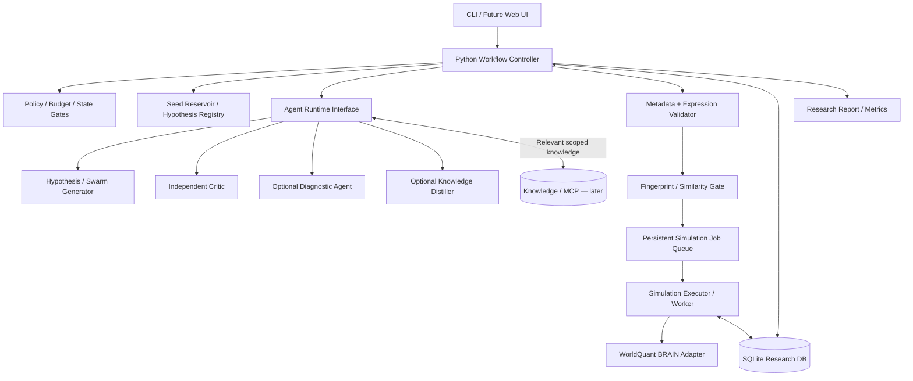
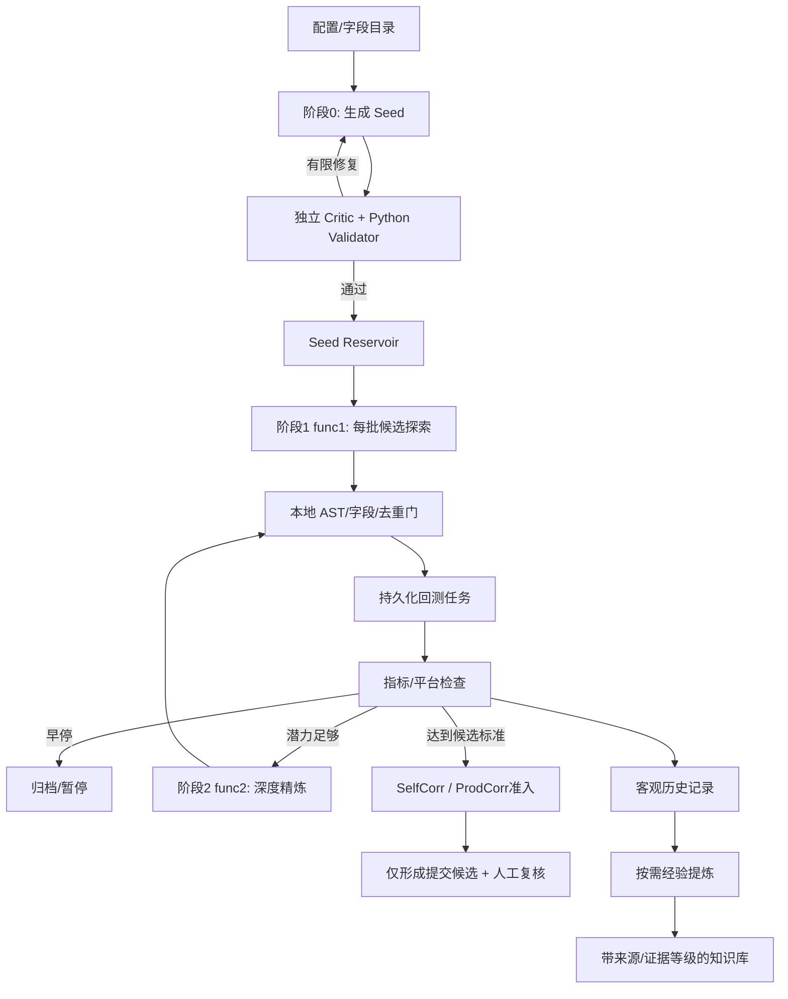

# WorldQuant Alpha Research Platform — Architecture & MVP Development Specification

开发上下文入口：[简短变更索引](dev_context/README.md)、[当前状态](dev_context/CURRENT.md)。
后续开发先按需加载这些记录，完整技术说明继续保留在 docs。

## M2-A 多 Agent 兼容基础层

新增独立的 Role → Runtime → Backend 接口、版本化任务、受限 Context 和 Agent 账本。
Mock 可执行生成与独立审查两类任务；旧 M1 research 命令保持不变。

```powershell
uv run --offline python scripts/demo_agent_interop.py
uv run --offline alpha-platform agent run --role generator --input configs/agent_generator_mock.json --ledger agent_tasks.sqlite3
uv run --offline alpha-platform agent run --role critic --input configs/agent_critic_mock.json --ledger agent_tasks.sqlite3
uv run --offline alpha-platform agent show --task-id sample-critic-v1 --ledger agent_tasks.sqlite3
```

Codex CLI 本地安装/登录预检已验证，但宿主隔离未验证，真实调用保持 UNSUPPORTED；
Claude Code 未安装，DSH 仅预留注册槽。未启动 M2-B～D、真实回测或 RAG。
详见 [操作说明](docs/AGENT_INTEROP.md)、[基线](docs/M2A_BASELINE_AUDIT.md)和
[交付报告](docs/M2A_DELIVERY.md)。

## M1 实现与运行

已实现离线最小闭环：Mock Generator → 基础 Validator → 去重/预算门控 →
Mock Simulation Adapter → SQLite 结果、审计事件与 JSON 报告。下面的原始开发规格保留。

需要已有 Python 3.11+ 与 uv。在项目根目录执行（PowerShell）：

```powershell
uv sync --locked
uv run --offline alpha-platform init-db
uv run --offline alpha-platform research run --mode mock --config configs/sample-gbr.json
uv run --offline alpha-platform research show <上一步输出的id>
uv run --offline pytest
uv run --offline ruff check .
```

首次 `uv sync` 需下载开发依赖；安装后运行和测试均无需网络或凭证。
`uv.toml` 固定缓存到项目内 `.uv-cache` 并禁止自动下载 Python；虚拟环境在
`.venv`，测试临时数据库在 `.pytest-tmp`。不需要 RAG 或 embedding 模型。
可通过全局参数 `--db <路径>`（放在子命令之前）指定独立数据库；默认
`research.sqlite3`。支持环境变量 `ALPHA_DB`；M1 只允许 `MODE=mock`。
`.env.example` 是配置参考，CLI 不自动加载 `.env`。

示例配置采用 JSON，避免引入 YAML 依赖。`mock_value`、`mock_rank`、指标和
门槛都是 mock fixture，不代表 WorldQuant 真实元数据或准入标准。
同表达式、相同回测设置重复运行会记录 DUPLICATE，不会再次入队。
报告包含任务、提交尝试、原始模拟结果、指标、门控、预算及事件。
UNKNOWN 请求不会自动重发，保留预算预留等待人工检查。

架构取舍和已知限制见 [docs/ARCHITECTURE.md](docs/ARCHITECTURE.md)。
尚未实现 live、完整 FastExpr、Critic、RAG、自动中断恢复及 M2～M4。

## M1-O 研究观察器

已增加只读 Run 概况、执行节点图、时间线、证据 Inspector、异常提示及 JSON/离线 HTML 导出。
业务审计始终开启；可选 Trace 支持 `off`（默认）、`light`、`full`，不会自动启动服务。

```powershell
uv run --offline alpha-platform research run --trace light
uv run --offline alpha-platform observe show --run-id RUN_ID
uv run --offline alpha-platform observe export --run-id RUN_ID --output diagnostic.json
uv run --offline alpha-platform observe report --run-id RUN_ID --output run.html
```

可以直接打开 [成功样例](examples/observatory/success.html) 或
[落库失败样例](examples/observatory/persistence-failure.html)。命令、大小限制、脱敏、
保留策略和历史数据局限见 [观察器说明](docs/OBSERVATORY.md)，基线核查见
[M1O_BASELINE_AUDIT.md](docs/M1O_BASELINE_AUDIT.md)。

## M1-O.1 中文历史回放

新增中文离线播放器：播放／暂停、步进、拖动进度、调速、异常跳转和证据检查。
历史状态按事件前缀投影，初始视图不会提前显示最终成功；同秒跨源顺序、缺失和
截断会明确标记。最终查询快照仅用于独立对照。

```powershell
uv run --offline alpha-platform observe replay --run-id RUN_ID --output run-replay.html
uv run --offline alpha-platform observe replay --run-id RUN_ID --format json --output run-replay.json
```

直接打开 [成功回放样例](examples/observatory/success-replay.html) 或
[落库失败回放样例](examples/observatory/persistence-failure-replay.html)。
详见 [中文操作说明](docs/REPLAY_STUDIO.md) 和 [R0 基线核查](docs/M1O1_REPLAY_BASELINE.md)。

---

**Version:** 0.1.0 · **Status:** Development-ready draft · **Date:** 2026-10-30

> 交付对象：Codex / 开发者。本文档区分**已达成的设计方向**、**MVP 实施决策**以及**后续扩展项**。AEGIS 为参考案例，不代表其未公开的功能已获验证。请先完成 M1 再逐步扩展，不要一次建成全功能平台。

## 0. 项目目标与边界

### 0.1 目标
开发以 **Python Workflow Controller** 为核心的 WorldQuant BRAIN Alpha 自动研究平台：从研究设定与字段元数据出发，生成可追溯经济学假设和表达式、执行本地静态验证、在批准额度内回测、归档结果，并最终演进为双阶段 Seed Reservoir + 群体探索 + 深度精炼 + 知识沉淀系统。

**MVP 成功标准：** 使用**模拟适配器**端到端完成一次流程；在提供合法凭证、具备平台访问权且接口已确认后，支持人工显式启用的一次真实研究：`设定 → 生成候选 → 校验 → 回测 → 读取指标 → 门控 → 持久化报告`。不得自动提交正式 Alpha。

### 0.2 设计原则
1. Workflow-first：业务状态、权限、预算、阶段切换由 Python Controller 管理；Agent 只负责生成、批评、诊断、经验提炼等认知工作。
2. Deterministic-first：字段合法性、类型、算子签名、指纹去重、预算、状态迁移、阈值决策由代码控制。
3. Evidence-first：原始实验事实与 Agent 的解释分层存储；经验不是验证过的事实。
4. Recoverable：任务、实验、预算和中间状态持久化；不可把 LLM 会话当成系统唯一记忆。
5. Safe by default：默认 mock/offline；明确启用 live 模式；模拟、检查、标签与正式提交权限分离；日志不得泄露密钥。
6. Pragmatic MVP：使用 Python + SQLite + `asyncio`，不引入 Celery/Redis/Kubernetes；保留接口以支持扩展。

### 0.3 非目标（MVP）
- 不保证产生高 Sharpe 或可提交 Alpha；不保证研究收益。
- 不实现自动正式提交、绕过平台限流或配额、未获授权的数据采集。
- 不实现完整 Pi 集成、生产级多 Worker Lease、跨进程 fencing、完整 RAG/MCP 知识库。
- 不以复杂大模型投票取代实证检验；不将回测优化结果当作样本外证据。

### 0.4 首轮研究环境
配置驱动，**以 GBR / TOP700 / DELAY 1 / EQUITY 为初始默认样例**；真实可用 Universe、中性化选项、门槛以及字段必须从已授权平台实际元数据/规则核实。不得硬编码不经验证的字段、算子、API 地址或当前门槛。默认参数只是用户可修改配置。

---

## 1. 全局架构



### 1.1 职责界线
| 组件 | 负责 | 不负责 |
|---|---|---|
| Controller | 阶段推进、预算、权限、剪枝、调度、恢复协调 | 生成金融解释或执行低层 HTTP 细节 |
| Agent Runtime | 模型调用、会话隔离、结构化响应、模型供应商适配 | 自主修改系统状态或绕开预算 |
| Generator | 提出信号假设、候选表达式、理由与出处 | 直接调用回测及正式提交 |
| Critic | 独立查找研究假设缺陷，仅反馈缺陷 | 将自己的猜测当作实证事实 |
| Validator | AST/语法、字段/类型、算子规则、配置合法性 | 判断经济学预测能力 |
| Queue & Executor | 可靠提交、轮询、结果落库、API 频控 | 决定研究方向或预算分配 |
| Knowledge | 相关经验检索、来源与证据等级 | 自动升级未经验证的结论 |

### 1.2 两类生命周期
- **研究生命周期**：主信号 → 初筛探索（func1）→ 深度精炼（func2）→ 相关性/平台检查 → 候选归档。
- **执行生命周期**：创建 Job → 预算预留 → 本地校验 → 远程提交 → 轮询 → 结果落库 / 异常对账。两个状态机不可混为一个字段。

---

## 2. 完整目标研究流程（逐步迭代实施）



### 2.1 阶段 0：Seed Reservoir（M2）
- 生成结构化主信号：`signal_id, research_config, dataset_id, field_ids, economic_hypothesis, base_expression, provenance, created_at`。
- 先验证字段存在、类型与算子约束，再由独立 Critic 审查经济学机制；Critic 不读取 Generator 的完整过程，只读取候选和必要原始证据。
- Critic 输出 `PASS|FAIL|UNCERTAIN` 与带 ID 的缺陷；失败可有限修复，默认上限可配置。分歧风险按需引入额外 Critic；数据泄漏/前视疑点不能通过投票豁免。
- 主信号与具体研究配置的研究状态分离：同一假设在某个 Universe 失败不代表全球失效。
- **AEGIS 对照**：其 `total_signals.json` 按地域/Delay/Universe→Category→Dataset 保存主信号，用 `times == 0` 标记未探索；我们额外维护显式状态与实验谱系。

### 2.2 阶段 1：func1 群体初筛（M2）
- 默认按 AEGIS 思想每批生成 **20 个**变体，10 个探索、10 个基于母本改造；批次规模及比例为可配置实验参数，不作为已证最优。
- 本地门控：算子/字段/参数校验；规范化后精确去重；AST 结构相似检测可标记参数微调，但不直接认定经济学等价。
- 初筛可参考 AEGIS 的整批 `max(abs(Sharpe)) >= 1.0`，但门槛必须配置化，不能直接替代区域正式提交标准。低表现可记录为当前设置下被剪枝。
- 优先记录所有尝试（包括失败/拒绝/超时），禁止只留最优解。任何批次生成与消耗的预算必须可追溯。

### 2.3 阶段 2：func2 精炼（M2）
- 仅对已通过初筛门槛的潜力信号展开更高成本探索；允许同数据集字段替换、算子替换、冗余结构删除及受约束的参数稳定性测试。
- 进入资格条件可以参考 AEGIS 的累计 ≥3 优质候选；指标定义与参数均配置化。
- 不承诺参数寻优一定提高样本外表现；保留搜索试次，避免多重测试被忽略。

### 2.4 风险与提交候选（M3）
- 平台 Checks、Sharpe、Fitness、Margin、Turnover，以及必要的稳健性检测分别保存。
- SelfCorr 可在授权取得同频、对齐的历史 PnL 后本地计算；ProdCorr 遵守平台当前频控。相关性数据不足时状态为 `NOT_EVALUATED`，不伪造通过。
- 系统最多创建 `CANDIDATE_FOR_MANUAL_REVIEW`；正式 Alpha submission 必须由人明确确认。可选平台标签操作应有独立开关及审计日志。

---

## 3. 状态模型与恢复

### 3.1 Research Run 状态
`CREATED → SEED_REVIEW → FUNC1 → FUNC2 → CANDIDATE_REVIEW → COMPLETED`；允许进入 `PAUSED`, `REJECTED`, `FAILED`。所有状态转换通过 Controller 校验；异常不自动等于研究假设失败。

主信号记录和研究运行分开：`Signal` 不等于 `ResearchRun`；在 GBR/TOP700/D1 的一次失败只影响对应配置和实验记录。

### 3.2 Job 状态
`PENDING → RESERVED → SUBMITTING → SUBMITTED → POLLING → COMPLETED`，并有 `RETRY_WAIT`, `UNKNOWN`, `FAILED`, `CANCELLED` 分支。`UNKNOWN` 表示远程副作用可能已经发生，不能盲目重发。

### 3.3 Checkpoint 原则
- 在本地事务中同时更新任务状态、预算预留和任务审计事件。
- 远程 API 调用发生于**数据库事务之外**；提交前保存请求意图，收到响应立即保存远程标识。
- Job ID 表示逻辑任务；Attempt ID 表示具体请求尝试；指纹去重与重试幂等是两件事。
- MVP：单进程 SQLite 队列；未知提交结果禁止自动重复提交（可以人工对账）。
- 后续：短 Lease + 心跳 + fencing token + 恢复 Worker。远程 Simulation Slot 不因本地 Worker Lease 释放就释放；由已确认的远程终态释放。
- 远程对账仅能使用平台实际提供的接口或可靠标识；不支持时保留 `UNKNOWN` 并明确上报。

---

## 4. 数据模型（推荐 SQLite）

| 实体 | 关键字段 | 约束/说明 |
|---|---|---|
| `research_runs` | id, config_json, phase, status, budget_limit, used_budget, created_at, updated_at | 当前研究及生命周期 |
| `signals` | id, dataset_id, hypothesis, base_expression, field_ids_json, provenance_json | 可复用经济学主信号 |
| `signal_trials` | id, signal_id, run_id, status, explored_count, stop_reason | 每个配置下研究状态 |
| `alphas` | id, signal_id, expression, canonical_expression, settings_json, fingerprint, parent_alpha_id | 表达式谱系与去重 |
| `sim_jobs` | id, alpha_id, run_id, status, remote_simulation_id, next_poll_at, attempt_count, lease_version | 持久化回测任务 |
| `job_attempts` | id, job_id, started_at, completed_at, outcome, remote_ref, error_class | 请求尝试与失败审计 |
| `sim_results` | id, job_id, metrics_json, checks_json, pnl_ref, completed_at | 原始平台输出需保留 |
| `research_events` | id, run_id, job_id, event_type, payload_json, at | 操作事件日志 |
| `critic_reviews` | id, signal_id, candidate_version, verdict, defects_json, evidence_refs_json | 独立审核、缺陷追踪 |
| `knowledge_items` | id, content, evidence_level, source_refs_json, scope_json, status | M3 知识沉淀 |

- SQLite 开启必要约束、唯一索引、外键与 WAL（适用时）。`fingerprint` 基于规范化表达式 + 影响结果的完整设置生成；版本化哈希输入，避免未来改变规范化规则引起混淆。
- 不使用 MD5 作为语义近似判断；SHA-256 只是工程指纹替代选项，**两者都不能识别参数微调的经济学相似性**。
- `used_budget` 只在定义清晰的计费/额度事件上变化；预留额度与已实际消耗额度分开统计，避免失败路径双扣。
- 错误类区分 `VALIDATION`, `RATE_LIMIT`, `NETWORK`, `REMOTE_UNKNOWN`, `REMOTE_FAILED`, `RESEARCH_FAIL`, `INTERNAL`。

---

## 5. Agent 契约与上下文工程

### 5.1 Agent Runtime 接口
提供统一 `generate_structured(task_type, context, response_schema) -> structured_output`，支持本地 mock 和一种真实 LLM 供应商的 OpenAI-compatible endpoint；凭证从环境变量读取。设计成可替换接口，Pi 仅列为后续可选实现，不能把控制流放入 Harness。

### 5.2 Generator 输出示例
```json
{
  "economic_hypothesis": "分析师预测修正可能产生滞后价格反应",
  "field_ids": ["<verified_field_id>"],
  "expression": "<expression_to_validate>",
  "mechanism": "为何可能有预测价值（待验证）",
  "source_refs": [],
  "parent_alpha_id": null,
  "change_reason": null
}
```
占位字段仅用于 Schema 示例，绝不能在 live 模式下直接使用。

### 5.3 Critic 输出示例
```json
{
  "verdict": "FAIL",
  "defects": [{
    "id": "D001",
    "category": "hypothesis_expression_mismatch",
    "description": "表达式未直接度量假设中的修正变化",
    "severity": "major",
    "evidence_refs": []
  }]
}
```
Critic 独立读取候选、元数据及证据，不直接查看 Generator 原始思考历史；只反馈缺陷，不代写修复。结构化格式通过不等于论证被证实；问题未解决的最大修复轮数、冲突时追加审查与预算均由 Controller 约束。

### 5.4 Context 策略（M3）
- Python 注入官方规则、当前研究配置、相关知识和少量历史标杆；Agent 在授权和预算内主动请求 MCP。
- AEGIS 对照：`operators.md` → `{REGION}_{DELAY}_{CATEGORY}.md` → `{REGION}_forum.md` → `summary.md`，同时使用 Top-5 与最多 20 个潜力候选抽样，以及随机知识探索。**这些是原帖机制，不是必需的 MVP 参数。**
- 知识条目分 `OBSERVATION`（实验观察）、`HYPOTHESIS`（待验证解释）、`VALIDATED_FINDING`（按明确标准验证），保存原始来源、适用范围、验证限制。
- 新 Agent Session 使用精简的阶段输入，不装载全部历史；完整研究事实在 DB 中，不能因会话重置而丢失。

---

## 6. WorldQuant API Adapter 与安全

定义抽象接口（实际接口形态以授权平台可用 API 为准）：

```python
class SimulationAdapter(Protocol):
    async def submit(self, candidate: SimulationRequest) -> SubmissionReceipt: ...
    async def poll(self, remote_id: str) -> SimulationStatus: ...
    async def fetch_result(self, remote_id: str) -> SimulationResult: ...
```

- 首先实现 `MockSimulationAdapter`：可重复的模拟回测数据、提交成功、失败、超时、UNKNOWN、限流、延迟完成等场景。
- 真实 `WorldQuantAdapter`：仅在用户提供授权凭证、适用接口文档和元数据后实现/启用；不得假设固定 URL、请求字段、幂等 key、任务查询能力或具体平台状态值。
- 运行模式 `MODE=mock|live`，默认 mock。`live` 需要显式环境开关及 CLI 确认；设置每次运行的调用上限与并发上限。
- 密钥仅存环境变量或本地秘密管理；不入库、不写日志、不提交 Git；提供 `.env.example`（无真实凭证）。
- 重试政策：429/临时网络错误按平台提示或受限退避处理；远程是否接受请求不明时转 UNKNOWN 并对账，不盲目重试。
- 轮询策略：优先平台 `Retry-After` 或明确提示，否则使用有上限的递增间隔 + jitter；Worker 释放 Lease 不释放远程并发 Slot。
- 平台正式提交操作与普通回测必须分离；MVP 不支持自动正式提交。

---

## 7. 推荐代码目录

```text
worldquant-alpha-platform/
├── pyproject.toml
├── .env.example
├── README.md
├── docs/
│   └── ARCHITECTURE.md
├── src/alpha_platform/
│   ├── config.py
│   ├── cli.py
│   ├── domain/               # enums, typed data models, decisions
│   ├── workflow/             # controller, state_machine, budget, policies
│   ├── agents/               # runtime interface, generator, critic (later)
│   ├── validation/           # expression parser, metadata rules, dedup
│   ├── simulation/           # adapter protocol, mock, live, executor, polling
│   ├── persistence/          # SQLite schema, migrations, repositories
│   ├── research/             # seed reservoir, func1, func2 (later)
│   ├── knowledge/            # distiller, evidence and retrieval (later)
│   └── reporting/            # summary and export
├── tests/
│   ├── unit/
│   ├── integration/
│   └── fixtures/
└── scripts/
```

目录是目标边界，M1 可只建立实际用到的文件，不要生成空壳模块。项目使用 Python 3.11+ 和 `uv`；异步 HTTP 库、ORM、结构化 LLM SDK 由 Codex 根据最简可维护性选择，避免不必要框架。

---

## 8. 里程碑与验收（严格按顺序）

### M1：可运行最小闭环（优先开发）
**范围**：配置、CLI、统一数据模型、Python Controller、Mock Generator、Mock Adapter、本地基础 Validator、SQLite、少量预算门控、任务结果保存与报告；可选接真实 LLM 的简单生成器。Critic 暂时可单独接入但不阻挡 mock 闭环。

**用户操作示例**（期望 CLI 设计，具体命令开发时定稿）：
```bash
uv sync
uv run alpha-platform init-db
uv run alpha-platform research run --mode mock --config configs/sample-gbr.yaml
uv run alpha-platform research show <run-id>
uv run pytest
```

**验收标准**：
- 在完全无外网、无 WorldQuant 凭证状态下，一个 mock run 能闭环并产生持久化报告。
- 重启进程后能查询之前的研究及 Job；同一规范化表达式和相同配置不被重复入队。
- 超预算任务拒绝提交；所有任务状态合法；错误与拒绝原因可追溯。
- 测试覆盖：正常成功、校验失败、去重、预算耗尽、网络超时未知、结果落库失败重试的幂等更新。
- 没有任何自动正式提交行为。

### M1.5：第一个真实回测（有条件执行）
**前置**：确认平台 API 文档、登录方式、账户可用频控和权限；配置真实字段及算子元数据；用户显式开启 live。
- 最多 1 个 Alpha、有限预算，手动审核表达式后提交模拟。
- 保存远程标识、原始响应与解析后的指标；无法确定状态时进入 UNKNOWN，不自动重复提交。
- 验收：一次授权回测从提交到结果持久化可追溯。若环境或权限不足，保持 mock 验收通过，报告阻塞项，不伪造 live 成功。

### M2：AEGIS 风格研究流程
Seed Reservoir、Generator/Critic、限定修复、func1 批量探索、阶段剪枝、func2 精炼、父子 Alpha 谱系与研究暂停/恢复；各门槛配置化。验证同一主信号重跑不会无意重复历史实验。

### M3：知识与稳健性
多层 Context、MCP/RAG、按需 Distiller、证据等级、历史潜力池、自适应知识探索；相关性校验与人工提交候选审核。评价知识注入是否真的改善发现效率。

### M4：长期运行可靠性
任务调度 Worker 分离、Lease/fencing、动态并发与频控、API 对账、自适应轮询、进程中断恢复、监控与日志指标。使用故障注入验证，不以只有 happy path 的测试视为完成。

---

## 9. 开发任务优先级（Codex 应立即执行）

1. 初始化仓库（`uv`、src 布局、pytest、ruff、类型检查可选），建立 README 与 `.env.example`。
2. 写 Domain Models：`ResearchConfig`, `Signal`, `AlphaCandidate`, `SimulationJob`, `SimulationResult`, `ResearchRun`；明确状态枚举。
3. 建 SQLite schema + repositories + 初始化/迁移入口；唯一索引和事务测试。
4. 定义 `SimulationAdapter` 并实现 Mock Adapter，包含确定性的成功、限流、未知请求等测试模式。
5. 实现最简 Validator + canonicalization + fingerprint；**先做规范化和基本可测试校验，不声称 AST 支持全部 FastExpr**。
6. 实现 `Controller.run_one_candidate`，在预算许可下完成入队、mock 提交、结果保存和门控。
7. 实现 `Generator` 接口 + Mock Generator，使整个流程可完全离线测试。
8. 提供 CLI 和研究报告；端到端测试全绿。
9. 完成后汇报：改动文件、设计取舍、测试结果、已知限制、下一阶段待办。**不要自动开发 M2~M4，先交付 M1。**

### Codex 执行约束
- 先运行现有测试；增量开发；不要修改用户已有其他项目或全局环境。
- 不要凭空创建或硬编码未经确认的 WorldQuant API endpoint、数据字段、算子、门槛。
- 不要把 Alpha 表达式拼成 Python `eval`/`exec` 执行；AST 校验使用受控语法/白名单规则。
- HTTP 调用、文件 I/O、数据库写入要有异常边界与结构化日志；日志内容脱敏。
- 每次对架构做实质更改，更新 `docs/ARCHITECTURE.md` 中的决策和理由。
- 如果已有仓库结构，优先融入现有项目，不要强制重建。

---

## 10. 关键待验证问题（不阻塞 M1）

1. WorldQuant 当前授权 API 是否可查询异步 simulation、支持何种异常恢复及频控？
2. 当前研究 Region/Universe/Delay 的可用字段、算子和中性化选项是什么？
3. 真实初筛与正式提交门槛及平台检查有哪些更新？
4. func1 20 个候选、50/50 探索比例及 Step1 Sharpe 门槛是否带来实际收益？需要消融验证。
5. Critic 提前审查是否能降低无效回测率，还是增加成本而没有实质收益？
6. Pi Agent 与 Python 原生 Harness 在工具管理、Session 隔离、延迟和开发维护上的比较。
7. 类似表达式/同源信号的相似性检测及多重测试偏差如何量化？

## 11. 验收指标和实验记录

每轮至少记录：生成数量、技术有效率、重复率、提交尝试数、回测成功率、API 调用次数、Token/费用（若可得）、耗时、各阶段晋级率、失败原因、有效候选数、回测参数与数据版本。不得只报告最终最佳 Sharpe。

## 12. 参考与归属

- 用户提供的 AEGIS Agent Workflow 帖子及流程截图：作为架构启发；文中效率数值为作者自述，**未经独立核验**。
- 用户与助手的架构讨论：Python Controller、独立 Critic、分层预算、Seed 状态与恢复、知识证据分级、增量验证、持久化队列。
- Anthropic Code Review 讨论：启发独立验证与按需额外审核；代码审核中的投票不等同于金融研究有效性的证明。

**最终开发要求：先把 M1 做成可运行、可测试、可恢复查询的系统；以真实失败案例推动 M2/M3/M4，避免先写一座空架构。**
